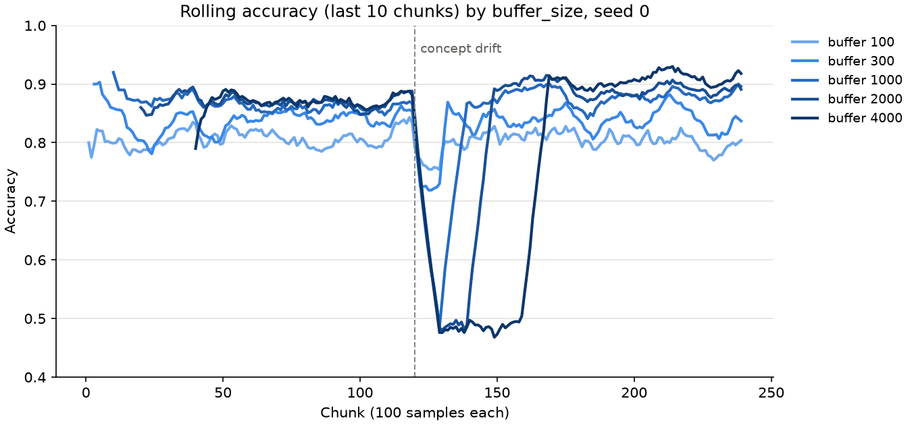

# Benchmark Results

Generated by `benchmark/run_all.py`. Environment: python 3.14.2, numpy 2.5.4, platform Linux-6.8.0-1064-azure-x86_64-with-glibc2.39, processor x86_64.

## (a) Loop-based vs. vectorised implementations

Minimum over interleaved runs (at least 5 rounds and 1 s per case) after 1 warm-up. Each pair was checked to return the same result before timing.

| Operation | Loop (ms) | Vectorised (ms) | Speed-up |
|---|---:|---:|---:|
| Split search (n=250, d=8, k=3) | 49.1 | 0.51 | 96.7x |
| Split search (n=1000, d=8, k=3) | 246.6 | 2.27 | 108.7x |
| Split search (n=4000, d=8, k=3) | 1769.1 | 10.59 | 167.0x |
| Tree predict (20000 rows, depth 8) | 102.0 | 3.47 | 29.4x |
| Accuracy + macro F1 + AUC (50 chunks x 200) | 4.1 | 11.59 | 0.4x |
| Accuracy + macro F1 + AUC (50 chunks x 2000) | 39.0 | 22.24 | 1.8x |
| Accuracy + macro F1 + AUC (50 chunks x 20000) | 396.2 | 123.76 | 3.2x |

- Split search: the loop is O(n^2 d) (a mask over n rows for each of ~n thresholds), the vectorised search O(n d log n), so the gap grows with n.
- Metrics: the loop baseline is a bare dict counter with no input checks. Each vectorised metric validates its chunk (label set via np.unique, mixed-type check), a fixed cost per chunk, so it loses on tiny chunks and wins on large ones.

## (b) Effect of `buffer_size` (accuracy and retraining time)

Drift stream (24000 rows, chunks of 100, rule changes at chunk 120), Imputer -> StandardScaler -> DecisionTreeClassifier(max_depth=6), test-then-train. Mean over 3 stream seeds (timings: minimum over seeds, as noise on this shared machine only adds time).

| buffer_size | Accuracy before drift | Accuracy after drift | Final accuracy | Lowest rolling acc. | Recovery (chunks) | Retrains | Retrain time (ms) | Total fit time (s) | Peak model memory (kB) |
|---:|---:|---:|---:|---:|---:|---:|---:|---:|---:|
| 100 | 0.808 | 0.800 | 0.796 | 0.760 | 5.3 | 240 | 2.2 | 0.54 | 3 |
| 300 | 0.841 | 0.833 | 0.835 | 0.734 | 7.7 | 80 | 4.5 | 0.40 | 12 |
| 1000 | 0.865 | 0.851 | 0.879 | 0.510 | 15.0 | 24 | 9.9 | 0.30 | 44 |
| 2000 | 0.875 | 0.830 | 0.894 | 0.485 | 25.0 | 12 | 15.5 | 0.25 | 87 |
| 4000 | 0.879 | 0.769 | 0.906 | 0.474 | 45.0 | 6 | 26.4 | 0.22 | 174 |

- Accuracy before drift: mean per-chunk accuracy over chunks 80-119. After drift: chunks 120 to the end. Final: the last 40 chunks (the level each model settles at).
- Lowest rolling acc.: minimum of the 10-chunk rolling accuracy after drift.
- Recovery: chunks from the drift until the 5-chunk rolling accuracy is within 0.05 of the final accuracy (so at least 5: the window must first fill with post-drift chunks).
- Retrain time: median time of the fit_chunk calls that rebuilt the tree.

Findings:

- A larger buffer gives each tree more data, so it is more accurate while the stream is stable and once it has adapted (before drift and final columns).
- But the tree only learns the new rule after retraining on a buffer of post-drift rows, so recovery takes about buffer_size / chunk size chunks (plus the smoothing window). The drift here falls on a buffer boundary for every size; in general it can take up to 2 x buffer_size samples. Until then the old tree is wrong on half the space (accuracy near 0.5).
- The trade-off shows in accuracy after drift: a medium buffer (1000) does best over the drifted part of the stream.
- Cost: one retrain gets slower as the buffer grows (more rows to sort), but total fit time falls because there are fewer retrains. Memory grows linearly with buffer_size (the buffered rows dominate the model's memory).

